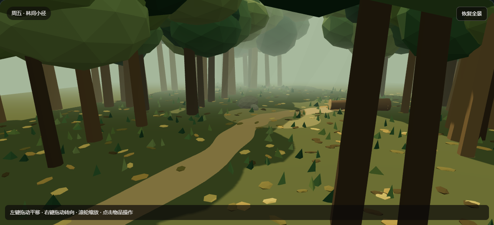

# 小型树林场景与课堂演示

当前：案件`vicarage_study/26`，发布场景包`study/6`；其中书房使用`study/5`，树林使用`woodland/1`。这是新增的玩家实地探索版本。原修订23及更早调查继续使用其已发布内容，不自动迁移。

## 约一分钟的展示路线

1. 从案件详情新建修订24，打开地点地图，点“前往树林”。展示树木、草丛、地面落叶、薄雾与侧光；拖动、转向和缩放查看环境。
2. 沿小径走到空地，再走近倒木旁。位置由后端保存，镜头只负责表现移动；远处没有拨开或采集入口。
3. 点击倒木旁地面的落叶，执行“拨开落叶查看”，说明这一步只是露出碎块，还没有获得样本。
4. 点击碎块，展示“树林现场：棕色晶体样本”已进入线索整理；返回寓所，将样本交送警方请海多克辨认。
5. 再次进入树林，展示已拨开的落叶和已采集状态，刷新后仍保留。可补充展示手机宽度与无WebGL时的同规则物品列表。

它展示的工程内容包括：第二场景切换、注册模型与调查入口绑定、服务器距离校验、显露与采集分离、幂等请求、存档恢复，以及观察结果与专业判断分离。本文提供可直接用于课堂演示的能力与步骤。

## 场景范围与原著边界

画面是一段林间小径和一处空地，采用林缘、空地、倒木旁三处定点步行。镜头平移、旋转和缩放不授予知识，也不改变后端位置。树木和地面装饰由制作阶段编写的确定性代码生成，运行时不调用模型生成几何体或执行外来代码。没有加入遗体、血迹、随机掉落或装备门槛。

原著依据是第23章的小空地棕色晶体及第25章海多克的外观初步意见，参见[案件文档](../cases/murder_at_the_vicarage.md)。周五玩家实地发现、倒木与落叶的发现过程、三处行走位置和申请时长属于游戏改编；不把原著后续人物相遇、伤害或抓捕倒填为已经发生。样本外观不证明化学身份、来历、留下时刻或声音成因。

## SceneRequirement登记与核验

当前执行配置通过`scene.locations`、节点／实体／入口、操作效果及路线登记执行；下面是本次表现要求的对应表。通用`scene.requirementBindings`仍属于未启用的作者协议，不能把本表冒充其运行时解释器。

| 要求 | 表现与关联 | 验收 |
| --- | --- | --- |
| SR-WOOD-01：进入与返回 | `node_garden_gate`／`garden_gate`／`point_garden_gate`；`enter_woodland`；各停留处的`return_study_*` | 单独进入不授予线索；跨场景返回、刷新及原请求重试保持同一调查 |
| SR-WOOD-02：林缘与空地 | `node_woodland_trail`、`node_woodland_clearing`；行走点`(0,0,5)`、`(0,0,-1)` | 只允许执行当前停留处的路线；不能猜倒木处的操作ID跳过位置检查 |
| SR-WOOD-03：倒木与落叶 | `node_woodland_leaves`／`woodland_leaves`／`point_woodland_leaves`；停留点`(2.8,0,-4.5)` | 近处才可检查；`brush_woodland_leaves`仅显露碎块，不发材料 |
| SR-WOOD-04：碎块 | `node_woodland_fragment`／`woodland_fragment`／`point_woodland_fragment`；初始隐藏 | 显露后实际查看`route_collect_woodland_sample`才取得`clue_woodland_sample`；收取后不继续渲染地上碎块，反复检查不重复发放 |
| SR-WOOD-05：环境可观察 | `node_woodland_trees`、`node_woodland_stones`及其登记外观 | 可查看已登记范围；树木、灌丛和石头说明不自动成为新证据或否定事实 |
| SR-WOOD-06：专业意见 | `crystal_opinion`与`clue_crystal_opinion` | 必须先取得样本、回到可联系警方的位置并实际申请；结果仍为外观初步意见 |
| SR-WOOD-07：备用入口 | 路线按钮、物品列表与三维点击共用同一API | 无WebGL明确提示，仍能完成同一套发现／检查／采集；不绕过距离或前置 |

装饰：背景树冠与树干采用实例化复用，草叶和散落落叶为装饰实例，侧光与雾为氛围表现；不暗示隐藏检查、声源鉴定或物证结论。所有可点击调查对象通过`SceneItem`匹配登记，路线按钮只使用后端当前返回的可执行操作。

## 渲染与保存

2026-11-01修复跨场景误报：R3F卸载旧画布后会延迟主动释放其上下文，旧监听必须随该画布清理，不能修改新画布状态。当前画布中断时保留Canvas等待恢复并请求重绘，也可用“重试三维画面”重建；初始化失败使用准确提示。恢复与重试不调用调查操作，不改位置、材料或案件修订。

树林独立懒加载，进入前不加载其场景代码。树干、树冠、草叶和地面落叶分别使用实例化批次；静止时按需绘制，行走约0.9秒，按真实经过时间结束动画，减少软件渲染时拖慢HTTP响应的情况。兼容减少动态效果设置。相机状态标记所属场景，书房与树林不会误用彼此的视角；游戏位置、显露和采集状态由后端负责。

新增`SceneLocation`和封闭的`Relocate`效果只接受已登记场景、有限坐标与行走点。沿用`ExecuteOperationMessage`及原事务、请求摘要、回执与序号校验，没有新增任意坐标移动接口。原作者修订23按字节冻结在`browser_investigation_v23.json`；新增可选配置字段在旧编码中省略。

完整操作见[手动指南](manual_test_guide.md)第0节；整案路线见[完整流程](full_case_walkthrough.md)第12节。真实模型整案脚本：`tools/verify_case_completion_live.mjs --woodland --positive`，实际重启后加`--woodland --restore`核对冻结快照。原失败评审与回执保留。

## 本次验收结果

验证：首轮后端171项通过，追加的场景权限／采集／旧23兼容及作者校验13项通过（未变更套件缓存）；前端17项单元、严格类型与生产构建、80项完整浏览器回归通过。正常配置实际进程重启后31项浏览器恢复通过，含树林当前位置、已拨开的地面、已采集样本和新24真实模型结案。

正常TokenHub DeepSeek：新24固定取证、实地采样到真实评审五项成立、明确结案和六组冻结复盘已通过。首次评审因引用了未选材料被拒，原论证／失败回执保留；在原调查中新建评审请求后通过，未放宽引用规则。最终新24、新23、新22及两份旧真实模型结案完整快照逐字段一致。原真实问询三组、连续接话、材料阅读与两份澄清焦点快照也逐字段一致。正常后端8080保留；验收时原前端5173已停止，已按项目脚本恢复，8091模拟服务关闭。
